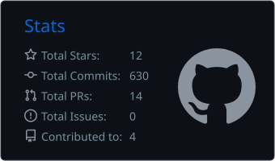
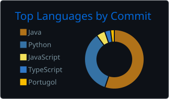

  

  
  

---

### 👨‍💻 About Me

Hi, I'm **Ryan** — a Software Engineer building resilient backend services and low-overhead systems tooling.

- 🔭 **Currently working as** a Consultant on mission-critical financial platforms, focused on core microservices and high-concurrency workflows.
- 🧠 **Backend & Architecture:** Java 21+, Spring Boot 3, Python, FastAPI, Apache Kafka, and Hexagonal Architecture.
- ⚙️ **Systems & Tooling:** Linux/Windows cross-platform apps, USB HID reverse engineering, and performance-sensitive desktop software.
- ☁️ **Cloud & Observability:** AWS, Azure, Docker, Terraform, Prometheus, and Grafana.
- 🎹 **Off the keyboard:** practicing sheet music on the piano or exploring Night City in Cyberpunk 2077.

---

### 🚀 Featured Projects

| Project | Stack | Highlights |
|---|---|---|
| [**payment-service**](https://github.com/ryan-mant/payment-service) | `Java 21` · `Spring Boot 3` · `Docker` | Event-driven payment gateway with Circuit Breaker and full Grafana/Prometheus observability (AWS Free Tier ready). |
| [**semantic-search-engine**](https://github.com/ryan-mant/semantic-search-engine) | `Python` · `FastAPI` · `Kafka` · `ChromaDB` | Event-driven semantic search engine implementing strict Hexagonal Architecture. |
| [**AreYouLowBattery**](https://github.com/ryan-mant/AreYouLowBattery) | `Python` · `PySide6` · `USB HID` | Zero-stutter wireless peripheral battery monitor for Linux & Windows with reverse-engineered 2.4G protocols and Game Mode. |

---

### 🛠️ Tech Stack & Tools

  

---

### 📊 GitHub Stats

  
  

  

